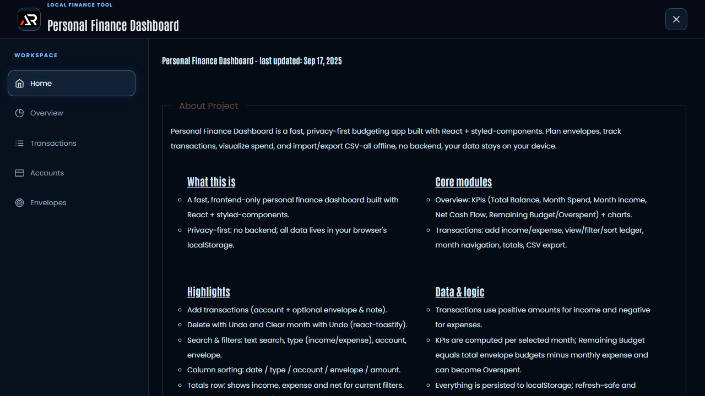

# Personal Finance Dashboard

A responsive, client-side finance dashboard for tracking transactions, accounts, and envelope budgets, reviewing monthly charts and KPIs, and exporting transactions to CSV.



## Features

- Monthly overview with balance, income, expense, net cash flow, and budget KPIs
- Income and expense charts with month navigation
- Transaction search, filters, sorting, totals, delete undo, and CSV export
- Account and envelope management with local persistence
- Responsive fixed header, independent navigation panel, active-link scrolling, and icon-only footer links

## Tech stack

React 19, Vite 8, React Router, Material UI, styled-components, Recharts, React Toastify, and browser LocalStorage.

## Run locally

Requirements: Node.js 20.19+ or 22.12+ and npm.

```bash
npm ci
npm run dev
```

Run `npm run lint` and `npm run build` before publishing. `npm run deploy` creates the GitHub Pages route fallback and publishes the production build.

Live URL: [a2rp.github.io/personal-finance-dashboard](https://a2rp.github.io/personal-finance-dashboard/)

## Data and privacy

The dashboard has no backend or account system. Finance data is stored in this browser's LocalStorage, which is not encrypted by this app and can be read by someone with access to the browser profile. Avoid entering bank credentials or other highly sensitive information, and treat downloaded CSV files as private. If browser storage is blocked or full, the app keeps changes in memory for the current session and shows a warning; those changes will not survive a refresh.

## Links

- Portfolio: [https://www.ashishranjan.net/](https://www.ashishranjan.net/)
- GitHub: [https://github.com/a2rp](https://github.com/a2rp)
- CodePen: [https://codepen.io/ash1198](https://codepen.io/ash1198)
- LinkedIn: [https://www.linkedin.com/in/aashishranjan](https://www.linkedin.com/in/aashishranjan)
- Facebook: [https://www.facebook.com/theash.ashish/](https://www.facebook.com/theash.ashish/)
- YouTube: [https://www.youtube.com/@ashishranjan-ashz?sub_confirmation=1](https://www.youtube.com/@ashishranjan-ashz?sub_confirmation=1)
- Email: [ash.ranjan09@gmail.com](mailto:ash.ranjan09@gmail.com)

## Support

- Support: [https://a2rp-donation-page.netlify.app/](https://a2rp-donation-page.netlify.app/)
- Buy Me a Coffee: [https://buymeacoffee.com/a2rp](https://buymeacoffee.com/a2rp)
- Patreon: [https://patreon.com/a2rp](https://patreon.com/a2rp)
